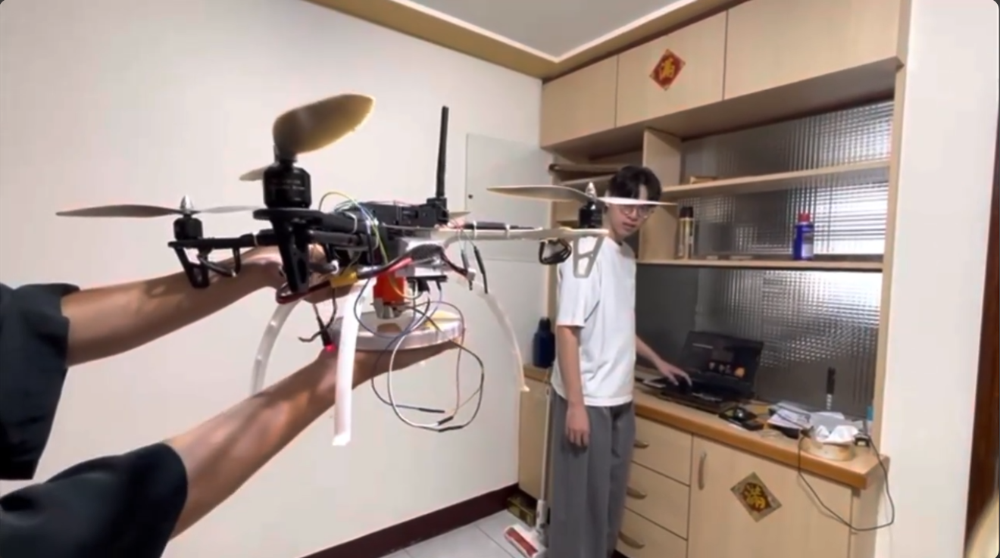
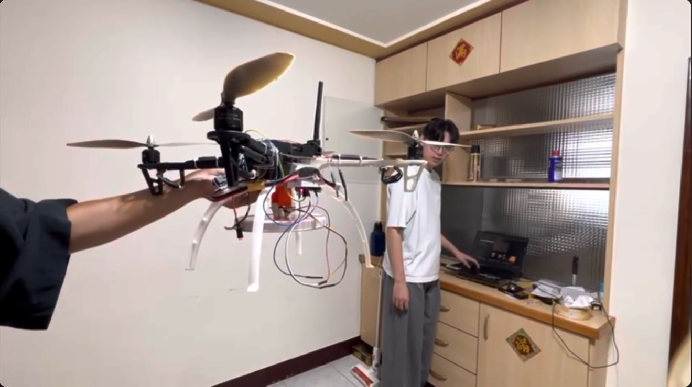

# UAV-Magnetic-Payload-Control[README.md](https://github.com/user-attachments/files/33592244/README.md)
# 無人機磁吸載物與電腦控制

本倉庫整理「無人機智慧配送」團隊專題中的電腦控制程式與磁吸上機測試紀錄。梁鎧晟負責電腦控制程式、磁吸指令介面、接線與地面站操作；實作重點為 DroneKit 連線、RC 通道覆寫、MAVLink 周邊指令與操作介面整合。

## 成果與驗證範圍

- 團隊完成磁吸機構上機與吸附、釋放操作測試。
- 依操作經驗，程式中的解鎖、油門、方向及磁吸切換功能均曾實機操作。
- 本倉庫的兩張測試圖呈現**人員托持機體**時的吸放狀態，不作為自由飛行、懸停穩定性或自主配送的證明。
- 影像測距僅曾在筆電端嘗試，未完成機載影像與飛控整合。本倉庫未收錄該原型程式，也未實現自主定位降落。
- 未保留完整載重、試驗次數與成功率資料，因此不作量化性能主張。

## 測試畫面

| 吸附狀態 | 釋放後狀態 |
| --- | --- |
|  |  |

畫面來自團隊原始試驗影片。兩圖依影片時序呈現吸放狀態。

## 檔案位置

| 檔案 | 內容 |
| --- | --- |
| [`code/controller.py`](code/controller.py) | 原始控制程式；原檔名為 `test329(2).py`，只重新命名以方便瀏覽，檔案內容保持原樣 |
| [`docs/project-report.pdf`](docs/project-report.pdf) | 四頁專題書面報告，涵蓋設計演變、分工、程式與測試；沿用備審原頁碼 19–22，文內 P18 指簽章分工表所在的主冊頁面 |
| [`requirements.txt`](requirements.txt) | 依原始碼匯入項目整理的依賴清單，未鎖定或驗證版本 |
| `assets/` | 磁吸吸放的原始影片截圖 |

## 程式架構

鍵盤輸入 → Python 操作迴圈 → DroneKit／MAVLink → 飛控與周邊輸出。

飛行操作使用 RC 通道 1–4 的覆寫；磁吸切換呼叫 `set_servo()`，使用 `MAV_CMD_DO_SET_SERVO` 發送第 5 輸出通道指令。OpenCV 視窗顯示飛控模式、油門設定與程式內部的磁吸開關狀態。

## 操作對照

| 按鍵 | 實際程式行為 |
| --- | --- |
| Space | 要求切換至 STABILIZE 模式並解鎖 |
| W / S | 增減油門，每次 30，程式範圍 1000–1800 |
| I / K | 俯仰通道控制 |
| J / L | 橫滾通道控制 |
| A / D | 偏航通道控制 |
| M | 切換磁吸指令，原程式的兩個輸出參數為 0 與 1900 |
| Z | 逐輪降低油門，到下限後要求上鎖；沒有高度或落地偵測回授 |
| Q | 要求馬達上鎖並結束程式 |

原程式曾將 Z 鍵顯示為「自動降落」，但其邏輯僅為逐步降低油門，不能視為已完成自主降落。Q 鍵也不是經驗證的飛行安全機制。保留原始文字，方便對照當時的實作。

## 環境與重現說明

原始專題使用 Python、DroneKit、pymavlink、OpenCV 與 NumPy。程式包含針對 `collections.MutableMapping` 的 Python 版本相容處理；當時完整套件版本未留存。

本倉庫為既有成果整理。**此次僅進行程式語法檢查與檔案整理，沒有重新連接飛控、重新執行硬體測試，亦未驗證目前套件組合可以直接運作。**

建立獨立環境與安裝依賴的參考步驟：

```bash
python -m venv .venv
# Windows 命令提示字元
.venv\Scripts\activate
python -m pip install -r requirements.txt
```

重現前需確認實際 Python 與套件相容性、COM 埠、baud rate、飛控韌體、通道功能與外接模組設定。程式會直接送出解鎖、RC 覆寫及上鎖要求，連接硬體測試前應先拆除螺旋槳。`0` 與 `1900` 是留存程式的參數，不能直接由此推論電磁鐵的通電極性、吸力或適用於其他接線。

完成環境與硬體確認後，程式入口為：

```bash
python code/controller.py
```

## 團隊分工

此為三人團隊專題，非個人獨立完成。比例沿用原教授簽章分工表，該表記錄原規劃；下表按期末簡報與實際完成內容整理。

| 成員 | 主要工作範圍 | 原紀錄比例 |
| --- | --- | --- |
| 吳冬羽 | 載物機構構想、加裝機構與元件試印 | 20% |
| 陳啟彥 | 遙控與 I/O、AirSim／Unreal Engine 模擬相關工作 | 40% |
| 梁鎧晟 | 電腦控制程式、磁吸指令介面、接線與地面站操作 | 40% |

本倉庫的集中整理與提交不代表當年的逐次開發紀錄；個人工作與比例另以原始分工紀錄佐證。模擬中的速度式控制與視角適配，和這份實機 RC 覆寫程式分開呈現。
